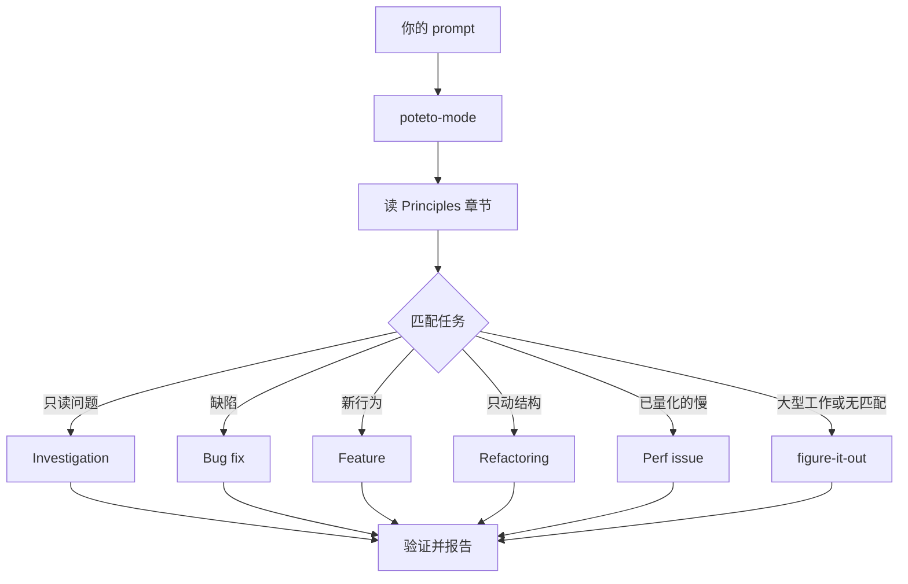

# pstack 指南（guide）1/4：安装、入口与代码理解

> 翻译自上游 `docs/guide/`（README、01-setup、02-poteto-mode、03-understand）。指南教的是使用习惯：别微观管理 agent，说清目标与完成判据，让 `/poteto-mode` 挑剧本、跑技能、给你证据。**本译文仅供人阅读，Agent 执行时读英文原文。**

---

## 指南总目录（guide/README.md）

pstack 在你停止微观管理 agent 时效果最好。你描述要什么、以及怎么知道它完成了。`/poteto-mode` 挑剧本、按步骤需要跑其他技能、把证据摆给你。这份指南用真实的 prompt 教这个习惯。

学习路线：

1. [安装 pstack](#安装-pstack01-setup)。装插件，选模型。
2. [经 `/poteto-mode` 路由工作](#经-poteto-mode-路由工作02-poteto-mode)。给目标，看它挑剧本。
3. [理解代码](#理解代码03-understand)。只读调查：`/how`、`/why`、`/teach`、`/recall`，然后才动手改。
4. [设计变更](04-design)（见第 2 篇）。`/architect`、`/arena`、`/swarm`、`/interrogate`、原型与计划，赶在代码锁定形状之前。
5. [构建与清理](05-build-and-clean)（见第 2 篇）。构建类剧本、`/tdd`、`/unslop`、`/no-comments`。
6. [验证与交付](06-verify-and-ship)（见第 3 篇）。在真应用上证明行为、形式化验证测试碰不到的部分、用 `/benchmark-checklist` 审数字，然后开聚焦的 PR 推到合并。
7. [睡觉时干活](07-overnight)（见第 3 篇）。先信任再循环、通宵契约、可审计的决策日志、跨 agent 扩展的 Projects 与 automations。
8. [用原则名转向](08-principles)（见第 4 篇）。24 个能在任务中途给 agent 转向的名字。
9. [把它变成你的](09-make-it-yours)（见第 4 篇）。你自己的 mode、`/correct` 治重复犯错、怎么测一次技能变更。
10. [配方与坑](10-recipes-and-pitfalls)（见第 4 篇）。可直接抄的 prompt 与要跳过的错误。

第一次按顺序读。之后每页独立成立。

卡住、或分不清哪个技能合适时，输入 [`/poteto-help`](https://github.com/cursor/plugins/blob/main/pstack/skills/poteto-help/SKILL.md) 带上你的问题：

```text
/poteto-help which skill should i use to review this branch?
```

它回答、递给你一个可发送的 prompt、并链接答案来源的技能或指南页。它不开工——pstack 一次运行花真金白银的 token，所以 prompt 由你在准备好时自己发。只在你输入它时运行。

### 如果只记住一件事

用你自己的话给 agent 一个目标和一个检查方式：

```text
/poteto-mode the export writes duplicate rows when a retry lands mid-run. repro first, then fix and verify.
```

不需要点名剧本、不需要列技能。"repro first" 加一个可检查的完成态，就是 `/poteto-mode` 需要的全部路由信号。它匹配 Bug fix 剧本、把步骤抄进待办清单、在每个步骤触发时调用对的技能。

---

## 安装 pstack（01-setup.md）

本页装插件、选 pstack 用的模型、跑第一个任务。安装是一条命令加一小段对话。

### 装插件

Cursor 聊天里运行：

```text
/add-plugin pstack
```

Cursor 确认插件装好。

Claude Code 里运行 `/plugin marketplace add cursor/plugins`，然后 `/plugin install pstack@cursor-plugins`。Claude Code 给插件命令加前缀，所以本指南的每条命令在那边带 `pstack:` 前缀，例如 `/pstack:setup-pstack`，它把模型规则写到 `~/.claude/rules/pstack-models.md`。其余差异见 Claude Code adapter。

其他宿主（OpenCode、Codex、Pi 等）用 `npx skills add backnotprop/pstack` 安装，模型规则写到 `~/.agents/pstack-models.md`，由各技能在选模型时主动读取（不自动加载）。

### 选模型

运行：

```text
/setup-pstack
```

[`/setup-pstack`](setup-pstack.md) 探测你有权访问的模型，问推理预算，展示每个角色（代码委派、判断、评审面板），问你要什么。回答问题。它写 `~/.cursor/rules/pstack-models.mdc`，一条所有 pstack 技能都读的小规则。

默认以 `xhigh` 推理运行，等价于 `large` 预算。`unlimited` 把每个模型提到最高档，上限 `max`。Opus 到 `max`。Grok 封顶 `xhigh`，所以留在那里。`medium` 与 `small` 降低推理、少花 token。

你只覆盖在意的角色。规则里没有行的角色保持技能默认。恢复默认：删掉那个角色的行。重跑 `/setup-pstack` 会保留任何模型与默认不同的角色。默认发生变化时，变更前写的规则仍钉着旧默认，所以删掉那些角色行、或删掉整个文件，再重跑 `/setup-pstack`。

你可能想知道用 Auto 会怎样。把角色设为 `inherit-parent` 或 `auto`，pstack 省略子智能体的 `model` 字段，子智能体继承你父级 chat 的模型。两个值同义，都不是模型 slug。面板角色的值是列表，每个条目跑一个子智能体，列表长度即面板大小。安装还配置 `swarm workers`——每个 `/swarm` worker 的默认模型，除非竞速为每臂点名模型。

### 接受或拒绝验证技能的提议

安装末尾，`/setup-pstack` 会找你项目里证明应用行为的手段——`verify-*` 技能或现成 harness。两者都没有时，它会提议一次用 [`/create-verification-skill`](create-verification-skill.md) 生成一个。

答应，它写 `.cursor/skills/verify-<app>/`，一个项目本地技能，教 agent 以用户的方式驱动你的应用。交付前它会实跑证明技能本身有效。拒绝，安装继续。你随时可以自己跑 `/create-verification-skill`。详见"验证与交付"篇。

如果你是 pstack 新手，答应。能自检的 agent 会一直跑到检查通过；不能自检的 agent 把每个结果都交回给你手工查。本指南所有内容里，验证技能回报最高。

然后安装会提议一次用 [`/create-formal-verification-skill`](create-formal-verification-skill.md) 生成形式化验证技能，除非项目已有。测试检查有人想到要写的用例；形式化验证技能检查代码的一个关键性质——例如"一个任务绝不同时跑两次"——在声明范围内的每一种情况下成立。你的代码有并发、重试、状态机或解析器时答应，那里缺陷代价高、测试很难碰到会坏的那个用例。否则拒绝，情况变了再跑。

安装后，开新 chat。模型规则只对新会话生效。

### 控制成本

pstack 在子智能体与评审面板上多花 token。这是严谨性的价格。少花的办法：

- 重跑 `/setup-pstack` 选更小的推理预算或更便宜的模型。主 chat 用强模型、代码角色用便宜快模型，是个好分法。
- 把角色设为 `auto` 或 `inherit-parent`，跑在 chat 自己的模型上。
- 缩短面板列表。每个条目跑一个子智能体。
- `/poteto-mode` 留给需要严谨的工作。小而显然的编辑不需要。

### 跑第一个任务

挑一件真实但小的活，像跟同事描述那样描述它：

```text
/poteto-mode add a --json flag to this command. text output stays byte-identical. verify both.
```

盯着待办清单。它最前面的条目是匹配剧本的步骤原样抄入——本 prompt 对应 Feature 剧本。`/poteto-mode` 跳过某步时，该步留在清单里标 `skip: <reason>`，你能看见它选择不做什么。

从这里开始你可以正常输入后续。想让 `/poteto-mode` 整个 chat 常驻：从 `/` 菜单选它并按 Option+Enter（Mac）或 Alt+Enter（Windows）而不是 Enter，使它成为 Custom Mode——每一回合都在上下文里，直到你退出。Custom Mode 在 Agents Window 与 CLI 可用。普通 Enter 只把技能附到一条消息上，聊着聊着就淡出。

---

## 经 `/poteto-mode` 路由工作（02-poteto-mode.md）

`/poteto-mode` 是前门。你给目标，它匹配 23 个剧本之一，把剧本步骤抄进待办清单，按步骤需要调用其他技能。本页教你好的 prompt 长什么样，以及其实你只需要多少。

### 你的 prompt 会经历什么



图里是常见路由。还有剧本负责：爬坡指标、诊断运行时症状与已捕获 trace、原型、视觉一致、撰写与评测技能、自主长跑、开 PR、看护 PR 或堆叠到可合并、交付已验证堆叠、自动驾驶 PR 队列或堆叠、编排项目级工程、会话接手、安全暂停、多阶段计划、worktree 清理。完整清单见剧本目录。

### 说目标，不说仪式

你不写规格。你说什么坏了或你要什么，加上你已知的、能省 agent 时间的任何东西：

```text
/poteto-mode users get two notifications after a retry. repro first, then fix and verify.
```

这是一条 Bug fix prompt。"repro first"是真约束，不是客套，剧本会遵守它。看着待办清单填上 Bug fix 的步骤。被跳过的步骤带着 `skip: <reason>` 留在可见处。

### prompt 里放什么

有用的 prompt 最多带五样东西，每样一句话：

- **目标。** 什么坏了，或你要什么。
- **完成检查。** 必须能通过或失败。"做得更好些"和"干一小时"都不是检查。
- **你想看的证明。** 要真实的命令输出、流程视频、存储的值、或前后对比数字。
- **你已知的。** 一个症状、一步复现、一行日志、或一个链接，省 agent 一次搜索。
- **真约束。** "repro first"、"先别改任何代码"、"零行为变更"、"继续前让我审"，每条都改变 agent 的行为。

五样俱全的例子：

```text
/poteto-mode the csv export drops its last row since yesterday's deploy. failing job id is 4812. repro first, then fix. done means the 60k-row fixture exports every row. show me the row counts before and after.
```

两样东西值得省略：

- **怎么做。** 说要达成什么，给 agent 留出找到比你选的更好的路径的空间。技能清单同理，见下面的坑。
- **你的原因猜想，至少一开始。** 说出口的猜想会把搜索收窄到你指的地方。先让 agent 复述问题，再分享你的直觉。

报告很吵（长帖、含糊的缺陷）时，把复述设为第一步：

```text
/poteto-mode read this thread. restate the underlying issue in your own words, in plain english. don't change any code yet.
```

误读会在复述里现形，早于任何代码存在。在那里纠正，成本是一条消息而不是一次错误修复。只要复述、不进剧本，跑 [`/in-your-own-words`](in-your-own-words.md)：它复述 agent 认为你的目标是什么、你想解决什么问题。

拿不准 prompt 是否瞄准了，发送前跑 [`/sharpen`](sharpen.md)：

```text
/sharpen write a migration guide for the v2 config format.
```

agent 会说：顶级专家会做但你没要求的事、他们会从什么最原始的材料出发、他们会用的方法与工具、除了你与 agent 之外什么能证明结果正确。然后重写你的 prompt，精确要这些——更深而不是更大——并把你的选择保持开放。它不做任务。读重写稿，然后发送，例如配 `/poteto-mode`。

### 后续消息要短

上下文已在对话里时，prompt 缩到几乎没有。这些都够：

```text
/poteto-mode do it
```

```text
continue
```

```text
keep going until done
```

短句有效，因为剧本持有结构，Custom Mode 让 `/poteto-mode` 每回合都在上下文里。你的话携带意图，技能携带严谨。

### 换话题用 "new task"

长 chat 积累上个任务的上下文。换主题时说明：

```text
/poteto-mode new task. figure out why the cache entry survives logout. don't change any code yet.
```

"new task" 告诉 `/poteto-mode` 重新匹配而不是继续上个剧本。"don't change any code yet" 把这条钉在 Investigation。少了这两句，处于 Feature 中段的 mode 会把你的问题当成下一个功能步骤。

### 给并行工作各自的机器

在同一台电脑上让多个 agent 打同一个仓库，它们会抢工作树、端口、构建产物。最干净的隔离是云子智能体：各自有自己的 VM 与分支，能装依赖、跑你的应用、录结果视频，不碰你的机器。任务前输入 `/in-cloud`，或让父 chat 把工作交给云子智能体。

工作必须留在本地时，提前要 worktree：

```text
/poteto-mode new task. branch off <base> in a fresh worktree, then port the parser change there.
```

每个任务自己的分支与 worktree，就没有 agent 踩另一个的文件。worktree 吃磁盘与机器资源，笔记本同时只跑得动几个。Opening a PR 剧本本来就在 worktree 里做代码变更，所以多数时候只在特定 base 或位置重要时才说。

worktree 会积累。磁盘紧了就问：

```text
/poteto-mode what's eating my disk? prune the worktrees that are safe to prune.
```

Worktree cleanup 剧本按合并状态、未提交工作、哪些会话还在触碰给每个 worktree 分类。只删证据放行的，有未提交工作的停下等你裁决。

### 离开时让它跑

要走开，说清"完成"是什么意思然后走：

```text
/poteto-mode im stepping away. keep going until the migration check reports zero old callers. log your decisions.
```

你之后才审阅的工作经 [`/figure-it-out`](figure-it-out.md) 路由，它设计运行阶段并保留 [`/show-me-your-work`](show-me-your-work.md) 决策日志。"睡觉时干活"篇讲完整的通宵契约。

**坑**：不要在 prompt 里枚举技能（"use /how, then /architect, then /arena..."）。剧本本来就给它们排序，手写序列常常重排或丢掉剧本本会保留的步骤。只在你想覆盖某个具体选择时才点名技能。

完整路由规则读 [`poteto-mode`](poteto-mode.md) 本体。

---

## 理解代码（03-understand.md）

> 源文件 5.2 KB。核心内容：先只读后动手的顺序——不确定代码怎么运作时，先用 `/how` 要一份架构走读（Overview / Key Concepts / How It Works / Where Things Live / Gotchas 五段）；想知道为什么长这样，用 `/why`，它并行查询七类证据源（源码控制、工单、长文档、实时聊天、基础设施可观测、错误追踪、产品分析仓库）并给出带引证的置信分级结论；想真正教会自己，`/teach` 把 how 与 why 织成一篇带图的平实讲解；想知道你自己的近期工作，`/recall` 从你的会话历史重建当前状态简报。
>
> 指南强调：这四个技能都是只读的，产出解释不改代码；调查结果里 agent 若给出"我们确定吗"类判断，要求它带理由说真话、前提错了顶回去（自主权一章的"坦率高于谄媚"）。
