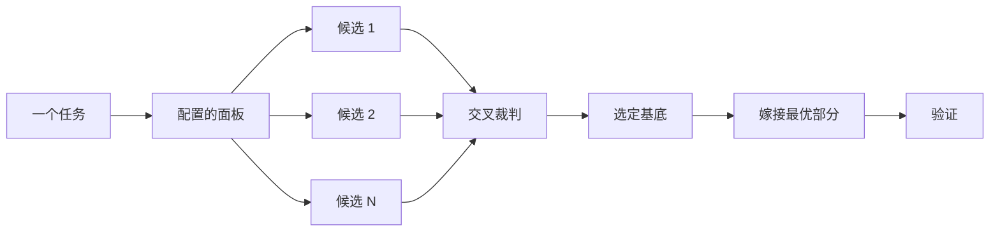

# pstack 指南（guide）2/4：设计、构建与验证交付

> 翻译自上游 `docs/guide/` 的 04/05/06 三篇（04-design.md、05-build-and-clean.md、06-verify-and-ship.md），合并为一篇。三篇合起来是一条主线：先用 `/architect`、`/arena`、`/swarm`、`/interrogate` 与原型把设计定型；再用构建类剧本把变更做出来并清理 diff；最后在真应用上证明行为、对测试很少够得着的性质做形式化验证、开聚焦的 PR 并把它推到合并。上游 README 路线图对这三篇的概括：**设计变更**——`/architect`、`/arena`、`/swarm`、`/interrogate`、原型与计划，赶在代码锁定形状之前；**构建与清理**——构建类剧本、`/tdd`、`/unslop`、`/no-comments`；**验证与交付**——在真应用上证明行为、形式化验证测试碰不到的部分、用 `/benchmark-checklist` 审数字，然后开聚焦的 PR 推到合并。**本译文仅供人阅读，Agent 执行时读英文原文。** 术语与译法基准见 [GLOSSARY.md](../GLOSSARY.md)。

---

## 先设计再写代码（04-design.md）

对一份困难的设计只尝试一次，会把模型最先想到的那个形状锁定下来。`/architect` 在实现之前把类型与边界定下来。`/arena` 对同一份任务简报（brief，任务简报）并行跑多次尝试，合并其中最好的部分。`/interrogate` 让其他模型设法击破结果。当你要的是覆盖面而不是设计综合时，`/swarm` 把切片扇出（fan-out，一对多并发派发）或开竞速，再把各自的结果汇总起来。

两个最常见的设计错误是：直接采纳 agent 的第一个设计；以及打磨一份没有任何代码检验过的计划。本页把这两个错误都修掉。你用代码做规划。原型回答开放问题，一份 README 或教程立起目标，成文的计划放在最后。


### 用 `/architect` 定形状

```text
/architect design the import pipeline before writing any code. i care most about how callers use it.
```

[`/architect`](../skills/architect.md) 先给自己找依据（grounded，有依据的）：对设计所触及的代码跑 `/how`，在设计移动所有权或层次时跑 `/why`。然后它跑 `/arena` 产出相互竞争的设计草图，每个草图都把调用方的用法写在最前面，随后是类型、签名和一张模块地图。

默认情况下，它会从综合出的设计直接推进到实现。想先看设计，就说清楚：

```text
/architect with checkpoint. stop and show me before implementing.
```

代码一旦开写，设计就不再神圣。如果实现显示同一个变通方案出现在互不相关的地方，或者类型只有靠 `any` 或强制转换才编译得过，`/architect` 就把这当作设计错了的证据。它会废弃草图、从头重来，而不是绕着它打补丁。

### 用 `/arena` 扇出尝试

```text
/arena take my prompt to the arena verbatim. i want to compare their proposals with yours.
```

[`/arena`](../skills/arena.md) 是底下那个通用工具。N 个 subagent（子智能体）并行尝试同一份设计或代码任务简报，各自写在自己的 worktree（Git 工作树）或目录里。一个来自不同模型家族的只读裁判（judge），对照评分基准（rubric）给每个候选打分。当没有其他家族的模型可跑时，协调者跳过裁判，自己挑选基底。协调者把每个候选从头到尾读完，选定基底（base），把落选者最好的想法嫁接（graft）进来，然后验证结果。



面板来自你的 [`/setup-pstack`](../skills/setup-pstack.md) 配置，而且可以按任务调整。决策代价高时多要几个候选，不值当时少要几个：

```text
/arena this, 5 candidates. the cache key format is expensive to change later.
```

### 用 `/swarm` 覆盖切片与竞速

```text
/swarm check every package under packages/ against its check.sh. one worker per package. one report.
```

[`/swarm`](../skills/swarm.md) 把 N 个 worker 扇出到相互独立的切片、覆盖矩阵、连环考验（gauntlet）泳道、探索分区、或事先声明好的竞速臂（race arm）上。每个 worker 拿到自己的范围与检查，然后报告 `PASS`、`ISSUES` 或 `BLOCKED`。父级等所有 worker 回来，返回一份紧凑的汇总报告，附上任何缺口或掉队者。

当并行能买到覆盖面、或能让相互独立的检查去竞速时，用它。`/arena` 给每个 worker 同一份设计或代码任务简报，然后选定基底并嫁接最好的部分；`/swarm` 则覆盖切片或跑一场竞速，选择规则在开跑之前就声明好，它不走选基底加嫁接的那套仪式。

### 用 `/interrogate` 击破它

```text
/interrogate the whole branch, but skeptically. no nitpicks unless it's an actual bug or regression.
```

[`/interrogate`](../skills/interrogate.md) 把变更连同它的意图，交给配置好的模型上的对抗者（adversarial，对抗性的），每个对抗者都通过对真实代码实际跑一次来设法击破它。不同的对抗者会找到不同的失败。一条审查发现（finding）只有在重跑它的命令能显示出一个破坏意图的失败时才算成立。报告列出每条已验证的发现及发现它的对抗者，随后列出每个对抗者丢掉了什么、为什么丢，并且什么都不动手改。

Dropped（已丢弃）清单也要读。裁决可以由你推翻。

### 用原型代替争论

永远不要拿第一个设计。要几个，然后从你看得见的证据里挑：

```text
/poteto-mode prototype a few options for the new dropdown menu. take screenshots or videos for me to compare.
```

[Prototype 剧本](./playbooks-01-task.md)（`playbooks/prototype.md`）在临时目录里搭一次性草样，把各个变体放到同一个切换器后面，逐个驱动，并捕获截图或计时。它同样适用于行为与算法，不只是 UI。原型就是用代码做的规划。它们让 agent 用"跑点什么"来回答自己的开放问题，而不是来问你，并且给一个你原本想不到的选项留出空间。

同一个思路可以放大到真正的设计。把 `/architect` 与原型配对使用，并保留一道评审门禁（gate）：

```text
/poteto-mode we need rate limiting for external webhooks. /architect it first, and answer open questions with prototypes. let me review before proceeding.
```

不要把对抗者花在一份抽象计划上。`/interrogate` 会丢掉每一条运行证明不了的发现，所以一份背后没有代码的计划，能留给它们击破的东西很少。让原型把问题裁决掉，然后评审构建出来的东西。

### 共享代码先写 README

对一个将被其他代码使用的包或 API，从用户会读的那份文档起步：

```text
/poteto-mode write a tutorial for how i would use the new config package first. then /teach me why it beats the current one.
```

先写教程，强迫你站到调用方的视角。你向一个假想用户描述这个 API，再倒推回实现。这份文档同时变成 agent 核对自身工作的具体目标。当文档本身就重要时，点名 technical-writing 技能，让教程保持为教程，而不是漂移成参考与解释混成一体。

### 设计定型之后再做计划

pstack 故意不提供规划技能。当你确实想要一份成文计划时，等设计定型之后再要：

```text
/poteto-mode turn this design into a plan. small verifiable PRs, each with its own verification steps.
```

[Multi-phase plan 剧本](./playbooks-01-task.md)（`playbooks/multi-phase-plan.md`）先用原型把剩余的开放问题裁决掉，然后每个 PR 写一节，每一节都以"证明该变更有效"收尾。光有一个通过的测试套件，不算那种证明。计划就是交付物。该剧本不实现它，并点名下一个应该执行它的剧本。

做迁移时，把标准写进 prompt：

```text
/poteto-mode plan the migration of our ui library to the new styling system. small verifiable PRs, each with visual regression checks. the result must match the original exactly, bugs included.
```

"bugs included"（连 bug 一起保持一致）防止迁移在半路上悄悄顺手修东西——那样新旧输出就再也无法对比。对一个跨越多天的项目，可以把计划在仓库里提交一阵子，让其他 agent 看见进行中的工作。工作落地之后删掉它。

### 一个任务配得上多少设计工作？

你可能在想：是不是每个变更都需要这一套。不需要。多数变更一样都用不上。一个粗略的阶梯：

- 一个小而完整、但你心里没底的变更，只配 `/interrogate`。
- 一个跨越函数边界或移动所有权的变更，配得上 `/architect`，它自带 `/arena`。
- 一个独立的决策——命名、格式、算法之类，独立尝试有帮助——直接上 `/arena`。
- 一个覆盖矩阵、一组并行检查、或声明了泳道的竞速，是 `/swarm`。
- 一个跑点什么就能回答的开放问题——一个布局、一段时序、一条技术路线——配原型，不配争论。
- 一个翻转代价高的争议设计，得到 `/architect`，交付之前再过一道 `/interrogate`。
- 跨越多个 PR 的工作，得到一份计划，写在设计定型之后。

`/poteto-mode` 本来就在套用这个阶梯。跨边界的工作会自行触发 `/architect`，所以你直接点名这些技能，主要是想要比默认更多或更少的审查强度时。

下一篇：「构建与清理变更」，见本篇下一节。

---

## 构建与清理变更（05-build-and-clean.md）

构建类剧本共享同一条纪律。说你观察到了什么，让剧本去向证据索要。本页先讲每个常见构建任务的 prompt 该放什么，再讲让 diff 保持可评审的清理习惯。

### 把你知道的喂给每个构建剧本

缺陷（bug）prompt 陈述症状，并要求先复现（repro）：

```text
/poteto-mode this command emits two records after a retry. repro first, then fix and verify.
```

新功能（feature）prompt 陈述行为，以及什么不许变：

```text
/poteto-mode add a --json flag. text output stays byte-identical. verify both forms.
```

重构（refactoring）prompt 在结构移动之前先钉住行为：

```text
/poteto-mode move parsing into one module, zero behavior change. record the current output first and prove it's unchanged after.
```

性能（perf）prompt 陈述测量，而不是陈述印象：

```text
/poteto-mode startup takes 1.8s on this fixture. trace it, fix the measured cause, show me before and after.
```

每一条都会路由到各自的剧本（[Bug fix](./playbooks-01-task.md)、[Feature](./playbooks-01-task.md)、[Refactoring](./playbooks-01-task.md)、[Perf issue](./playbooks-01-task.md)），而剧本会补上你没有打出来的那些步骤：先复现再修复、先给数据形态命名再实现、先钉住行为再动结构、先剖析再优化。

要对一个数字做持续改进，有 [Hillclimb 剧本](./playbooks-01-task.md)（`playbooks/hillclimb.md`，爬坡）。给它指标、目标和一个尝试次数下限，它以一套冻结的测量装置（harness，宿主环境）一次循环一条假设。它保留有效的胜利，回退其余一切。

两个 perf 剧本都会对各自的数字跑 [`/benchmark-checklist`](../skills/benchmark-checklist.md)。Perf issue 审查基线及其后的每一个数字；Hillclimb 在冻结装置之前先审查装置。什么时候需要你自己输入这条命令，见本篇"验证与交付"一节中"用 `/benchmark-checklist` 审查一个测量出的数字"。

有时候你要的是原因，先于任何修复。对一个活体症状——泄漏、空闲 CPU 空转、视觉毛刺——[Runtime forensics 剧本](./playbooks-01-task.md)（`playbooks/runtime-forensics.md`，运行时取证）给运行中的进程装仪表。对一份你已经捕获的 profile，[Trace forensics 剧本](./playbooks-01-task.md)（`playbooks/trace-forensics.md`，轨迹取证）读制品（artifact，制品）、把热帧映射回源码。两者都返回诊断，不返回修复：

```text
/poteto-mode here's a cpuprofile from the slow startup. tell me where the time goes and which source lines own it. no fix yet.
```

### 用 `/tdd` 先写失败的测试

当一个缺陷有廉价的本地测试路径时，整条 prompt 可以只有两个词：

```text
/tdd implement
```

在上下文里，这就够了。tdd 技能先写出以预期理由失败的最小测试，然后写修复，然后重跑那个测试。如果一个测试需要大范围的宿主环境（harness）搭建或脆弱的 mock（模拟对象），该技能会直说，并改用最接近的可执行检查来代替。真实命令是更强的证据时，不要硬塞一个测试。

### 按名字加载 TypeScript 规则

typescript-best-practices 技能把类型系统原则变成具体规则：可辨识联合（discriminated unions）、边界处用 `unknown`、变体穷尽、由 schema 派生类型。它不会自己加载，所以任务触及 `.ts` 或 `.tsx` 文件时，输入 `/typescript-best-practices`。

### 提交之前先清理

[Opening a PR 剧本](./playbooks-01-task.md)（`playbooks/opening-a-pr.md`）在每次 commit 之前对 diff 跑 `/deslop`，并对 PR 描述与 commit 正文应用 [`/unslop`](../skills/unslop.md)。`/deslop` 随 `cursor-team-kit` 插件发布，不在 pstack 里。你没有它时，就用平实的话要同样的结果：删掉叙述性注释、没有依据的守卫（guard）、死掉的兼容路径、和不相关的改动。

对文字（prose），`/unslop` 收一个目标和你的任何附加规则：

```text
/unslop the readme changes, no emdashes
```

你会发展出自己的简写。像 `unslop that, tighten it` 这种短 prompt，该技能读起意图来毫无压力。

### 用 `/no-comments` 剥掉注释

注释需要单独一轮清理，而且不能由写下它们的那个 agent 来做。作者维护自己注释的方式，就像你维护你自己的一样。所以评审之前，把它们交给一双新眼睛：

```text
/no-comments the diff
```

no-comments 技能（`/no-comments`）派出 Comment Sicko（保留不译），一个只读评审者，持有一份很短的保留清单：许可证头、公共 API 上的文档注释、解释代码解释不了之事的链接、由你无法重塑的外部依赖所强制的行为。其余全走。为你自己代码里的意外做解释，换不来这种宽免：那条注释会以重构标记的形式回来，而 `/no-comments` 在根因处修掉它接受的标记。当一条注释主张一个约束——"do not remove"——该技能会提议把这个主张编码成一个类型、一个测试或一条 lint。无论走哪条路，注释都会被移出来。

分工值得记清楚：`/deslop` 把 slop（AI 生成的低质冗余内容）从代码里清出去，`/unslop` 把它从文字里清出去，`/no-comments` 把注释交给一个没写过它们的评审者。

**坑**：清理不是可选的抛光。一份带叙述性注释和防御性死代码的 diff，在评审者眼里就是没写完，而多余的代码正是下一个 bug 藏身的地方。diff 摸起来发虚，就在 commit 之前说 `deslop it`，别等评审来点名。

下一篇：「验证与交付」，见本篇下一节。

---

## 验证与交付（06-verify-and-ship.md）

"能编译"不是证据。prove-it-works 原则（principle-prove-it-works，证明它有效）要求 agent 在报告成功之前检查真实的制品（artifact，制品），而你的工作是让"真实的制品"变得可检查。本页覆盖：陈述完成判据、审查一个测量出的数字、为你的应用生成验证技能、对测试很少够得着的性质做形式化验证（formal verification）、开 PR，以及把它一路推进到合并。

验证是多数 agent 工作里最慢的一步，因为它通常是那个要等人类的一步。让 agent 自己能做验证，你就不再是瓶颈。跳过它，跑再多 agent 也只是堆出更多没人检查、等你评审的活。


### 开头就说清完成判据

把"做完"是什么意思放进第一条 prompt，用什么措辞都行：

```text
/poteto-mode add json output to this command. text output stays byte-identical, the json parses, both run against the sample project. show me the evidence.
```

现在 agent 手上有三个可以运行的检查，而不是一种要伺候的情绪。回复回来时，它应该带着确切的命令和输出。某个检查跑不了时，好的回复会说"结果不确定（inconclusive）"。自信却没有证据的回复，是一个危险信号。

让检查去匹配变更：

- CLI 变更，就跑真实命令。
- UI 变更，就在跑起来的应用里走一遍被改的流程。必须与参考图逐像素一致时，[Visual parity 剧本](./playbooks-01-task.md)（`playbooks/visual-parity.md`）把截图和冻结的基线做图像 diff，而不是用眼睛评。
- 解析器或迁移，就回放一份存好的输入。
- perf 变更，就对比前后的 profile。
- 存储变更，就把写进去的值读回来。

要那种你自己能翻看检查的证明制品：先失败后通过的测试、一段前后对比的视频、trace、截图。修复已经合并进主干的，就在 main 上把同一个检查再要一遍。制品胜过一段头头是道的解释，因为你可以拿它去质问，而不必重放整场运行。

对一个小 diff 你又信不过时，[`/blast-radius`](../skills/blast-radius.md) 会找出它可能在别处弄坏什么。它找到那个让变更变得安全的唯一事实，并用运行代码来证明那个事实，而不是靠论证。

### 用 `/benchmark-checklist` 审查一个测量出的数字

前后对比的数字，是最容易在无意间搞错的证据。一侧热了缓存、一侧是 debug 构建、或者被测的工作根本没跑进计时区间——任何一条都能造出一个像模像样的加速。在报告一个数字或依据它行动之前，输入：

```text
/benchmark-checklist vet the export speedup before it goes in the pr
```

[`/benchmark-checklist`](../skills/benchmark-checklist.md) 问七个问题，每个都要一次运行的证据：

1. 限制这个数字的是什么，为什么不是双倍？
2. 每一侧是否都按生产环境的调优状态跑的？
3. 结果有没有突破物理上限，比如磁盘带宽或核数？
4. 有没有出错或输出错误结果？
5. 换着跑能不能复现，有中位数和区间吗？
6. 端到端有没有影响，在用户等待的那条路径上？
7. 被测的工作真的发生在计时区间里吗？

结论以更快、更慢、无可测量差异、或不确定（inconclusive）返回，附运行次数、区间和限制因素。它说不出限制因素、或有一侧没按调优状态跑时，结论就是不确定。`/poteto-mode` 已经在 Perf issue 与 Hillclimb 剧本内部跑这份清单，所以清单之外的测量归你自己输入这条命令，别人的数字好得不像话时也一样。它是 explain-the-number 原则的工作形态。

### 创建项目验证技能

上面 UI 那条背后藏着一个真实前提：agent 需要一套脚本化的方式来驱动你的应用。项目里已经有，很好。没有，就运行：

```text
/create-verification-skill
```

[`/create-verification-skill`](../skills/create-verification-skill.md) 访谈的是仓库，不是你。它自己弄清楚：用户会碰什么、应用在本地怎么启动、什么东西能驱动（drive，操作被测应用）它（有现成的 harness 优先，否则是浏览器加 CDP、PTY、或纯 HTTP）、什么证据能证明行为、以及两个实例能不能并排跑。只有代码答不上的问题，才会拿来问你。

它写出 `.cursor/skills/verify-<app>/`：一份面向 agent 的说明，带精确的 Launch、Doctor、Drive、Evidence、Cleanup 五节；一节 Helpers 装它附带的所有脚本；还有一个 `features/` 下的功能地图（feature map），索引这个应用做什么、以及什么结果证明每个功能有效。该技能自带一份可直接照抄的功能地图示例（feature-map-example），一个 README 索引加每个功能一个文件，使用规定的四个 H2。在交付之前，生成器会把技能端到端实跑证明一遍：启动、doctor 检查、驱动一个功能、捕获证据、清理，然后确认证据在清理之后还活着。那次证明失败，输出就不要用。

从那一刻起，"在应用里验证一遍"就是任何 agent 都能执行的步骤——在这个仓库里，不需要任何开场对齐。想要证明以特定形式交付时，在 prompt 里点名它：

```text
/poteto-mode build the bulk-archive action. use /verify-<app> to verify your changes and show me a video and screenshots as proof.
```

```text
/poteto-mode repro this with /verify-<app>. if it repros on main, fix it and show me a video as proof.
```

验证技能一旦可用，[`/swarm`](../skills/swarm.md) 就能按功能地图条目把一轮全量验证拆开、再汇总结果。一群验证者还能在大样本上确认一项 perf 收益，或在 PR 交付之前对应用做模糊测试找回归。

把验证技能当基础设施，不是一次性工具。提交它，让团队里每个人、每个 agent 都用同一种方式驱动应用。然后 build the lever（造杠杆，principle-build-the-lever 原则）。当 agent 们不断写一次性脚本去点应用时，要一个小型控制 CLI，让技能改为调用它。agent 少花 token，每次运行变得可重复。一个 agent 用得顺手的 CLI 有这些特征：

- 少数几条可组合的命令，每条都干真活，而不是一大堆薄命令。
- 任何破坏性操作都带 `--dry-run` 选项。
- 子命令把功能逐步揭示出来，而不是一次性全端上来。
- 错误信息说的是"接下来该怎么做"。
- 内容丰富的 `--help` 文本。
- 机器可读的输出，比如 JSON。

顺手把开发环境也做成可重复的：种子数据、测试用户、以及一条每次都能以同样方式把环境拉起来的命令。

### 让验证技能保持诚实

应用会变，功能地图会过时。下面这条至少每天跑一次，最好挂进定时 automation，免得要靠谁记着：

```text
/maintain-verification-skill
```

[`/maintain-verification-skill`](../skills/maintain-verification-skill.md) 审计生成的技能：每个功能并行一个只读的源码读取器，然后一轮 live pass 把每个已映射的功能都驱动一遍。它的结局恰好是三种之一。`clean` 意味着覆盖完整、没有要交付的东西。`changed` 意味着一个 PR 的已证明修正，全部圈在验证技能自己的目录之内。`blocked` 会点名阻塞者。它从不编辑产品代码。live pass 抓到产品回归时，它报告这个回归，而不是用一次文档改动把它盖过去。

### 用形式化验证技能证明一个性质

验证技能证明的是你驱动的那些路径。有些 bug 住在没人驱动的路径上：两个重叠的重试、一把在写入中途过期的锁、一个乱序到达的状态变更。测试很少够得着这些用例。对这类 bug 代价高昂的代码，就运行：

```text
/create-formal-verification-skill
```

[`/create-formal-verification-skill`](../skills/create-formal-verification-skill.md) 从代码里挑目标：代码做出的一个承诺，破坏它会伤到用户、且测试很少够得着破坏它的那个用例。它挑最强的目标，不是最容易验证的目标。想从某个区域或某个 bug 起步，就点名：

```text
/create-formal-verification-skill the job lease and retry logic. a job must never run twice at once.
```

问题挑工具。"事件能不能以坏的顺序发生"适合模型检验器（model checker）跑在设计的一个小模型上，任何语言里 TLA+ 都是这项的默认选择。"代码对每个输入是否表现正确"适合跑在代码本身上的验证器。你的语言没有可用的验证器时，agent 会直说，并用生成的输入测试真实代码，而不是给函数造一个手写模型。一个必须在任意规模下都成立的性质，可能需要一条证明。agent 会告诉你它选了哪个工具、为什么。

它验证一个性质，并在代码的一个被弄坏的变体上展示这个性质失败——因为你从没见过它失败的检查，证明不了任何东西。当前代码本来就破坏该性质时，你拿到反例（counterexample）：一串用你代码的术语写成的短步骤。性质保持原样陈述，所以发现就是发现（findings stay findings，不得弱化）。产品代码不变，除非你开口要。

它会写一个项目本地技能，告诉下一个 agent：一次变更是否触及被验证的代码、怎么用一条命令跑检查、怎么区分真实 bug 和建模错误。交付之前，生成器会照着这个技能，对一个故意破坏该性质的临时变更跑一遍，检查必须抓住它。交接说明里写清：验证了什么、用什么工具与界限（bounds）、检查发现了什么、以及它不覆盖什么。一次通过覆盖的是模型或界限，不是整个系统。

该技能还记录每条检查覆盖哪段代码、以及检查最后一次与它匹配时的 commit。绕过该技能的合并与重构，会让检查继续在一段早已消失的代码的描述上通过。这类操作之后，跑 [`/maintain-formal-verification-skill`](../skills/maintain-formal-verification-skill.md)。它从代码出发更新验证、重跑、展示每条更新后的检查仍然会失败，并告诉你每个失败究竟是验证的漂移（drift），还是代码里的 bug。

### 把行为画成状态图

模型术语里的反例能说服你。拥有这个行为的产品经理或设计师，需要用他们的术语看见它。运行：

```text
/statechart what the user sees when they edit a note offline
```

[`/statechart`](../skills/statechart.md) 从一个 TLA+ 模型生成一张"用户所见"的 Mermaid 状态图（statechart），所以图和被检验的模型不会漂移成两张皮。读者的规则（"你离线时永远不会看见 Synced"）变成不变式（invariant）。图上标出每个破坏规则的 State，报告用读者的话给出到达它的最短路径。交接之前，agent 会在真实代码里复现每条 bug 路径，所以建模错误不会伪装成 bug 到达读者。

### 开 PR

```text
/poteto-mode open the pr. small ordered commits, evidence in the description.
```

[Opening a PR 剧本](./playbooks-01-task.md)（`playbooks/opening-a-pr.md`）在 worktree 里工作，把工作 rebase 成小的有序 commit，清理 diff，把文字做去 slop 处理，然后交回 PR 链接。五个窄 PR 胜过一个肥 PR，堆叠（stack）起来的后续项胜过一条越滚越长的分支。

### 用 Babysit 把 PR 推到可合并

一个开着的 PR 会立刻开始积攒阻塞：检查挂了、评审者留言了、trunk 又动了。把这摊搅动交给 [Babysit 剧本](./playbooks-02-autonomy.md)（`playbooks/babysit.md`，看护）：

```text
/poteto-mode babysit this pr. get it green.
```

Babysit 盯着 PR，GitHub 或 Origin CLI 可用时用它自带的 watcher，并按顺序处理阻塞：先冲突，再评审线程，再 CI。所有已知修复批量成一次 push，让检查重启一次，而不是每修一个重启一次。评论分诊是怀疑式的，因为人类和 bot 会把真问题和噪音投进同一张列表。真实的发现配一个修复，噪音则带着反证在线程上驳回。你只想要个状态时，就问得小一点，Babysit 直接作答、不启动循环：

```text
/poteto-mode check on pr 123. anything outstanding?
```

Babysit 停在 merge-ready。它从不合并，哪怕全绿，因为合并是另一个决定。

### 用 Shipping 把堆叠落地

绿不等于安全。准备好落地时，明说：

```text
/poteto-mode land the stack.
```

[Shipping 剧本](./playbooks-02-autonomy.md)（`playbooks/shipping.md`，交付）在武装任何东西之前，逐个独立验证每个 PR。每个 PR 一个全新的 agent 现场证明行为，而且裁决一个变更的 agent 绝不是写它的那个。然后 Shipping 只从底部落地连续已验证的那一段，默认走 GitHub、Origin CLI 可用时走 Origin，一次一个 PR，并报告第一个打破链条的 PR。一个已验证的 PR 压在未验证的 PR 之上时要等，因为现在合并它会把那段空档拽到脚底下。

下一篇：「睡觉时干活」（07-overnight.md），见第 3 篇译文。

---

> 术语与译法基准见 [GLOSSARY.md](../GLOSSARY.md)。本篇对应的上游源文件：`docs/guide/04-design.md`、`docs/guide/05-build-and-clean.md`、`docs/guide/06-verify-and-ship.md`。
