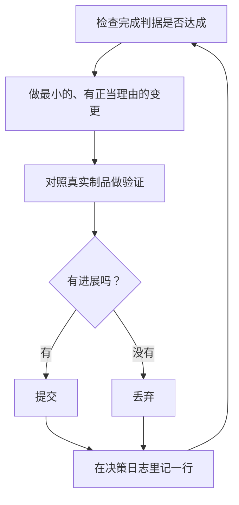

# pstack 指南（guide）3/4：通宵运行、原则转向与个人化

> 翻译自上游 `docs/guide/` 的 07-overnight.md（睡觉时干活）、08-principles.md（用原则名转向）、09-make-it-yours.md（把它变成你的）三篇。三篇分别讲：睡前赚得信任、写下通宵契约、用决策日志做早上审计，并把同一份信任放大到 PR 队列、多个 Project 与自动化的 automation 流水线；用 24 条原则的名字在任务中途给 agent 转向；以及生成你自己的 mode、沉淀会话教训、修环境、创作与盲测技能。**本译文仅供人阅读，Agent 执行时读英文原文。** 术语基准见 [GLOSSARY.md](../GLOSSARY.md)。上游把每一条原则都链接到各自的 `principle-*/SKILL.md`；本仓库将 24 条原则全文合译在 [principles.md](../skills/principles.md)，下文的原则名统一链接到该文件。

---

## 睡觉时干活（07-overnight.md）

这一篇是前面所有内容积累下来的回报。一个你能信任它去验证自身工作的 agent，就是一个你可以放手让它独自去面对困难任务的 agent。让这件事变得安全的不是希望，而是三样东西：一个可检查的完成判据、一个隔离的 worktree（Git 工作树）或一个云子智能体（subagent），以及一份你在第二天早上审计的决策日志。


### 先赚得信任，再开循环

一个你不信任的循环，只会以更快的速度产出没人检查过的工作，而这份混乱会随每一次迭代复利式累积。在你留下一个循环、放手让它自己跑之前，先逐条确认它已经挣得这份信任：

- 你亲手做过一次这个任务，或者看着一个 agent 完整地做过一次，所以你知道"做得好"长什么样。
- agent 手里有你自己也会用的那几样工具与信号：验证技能、性能分析器、日志。
- 每一个阶段都证明自己的工作，并且当工作达不到标准时，能让整条产线停下来。
- 你读过若干份会话记录，并且已经把反复出现的失败变成了工具、技能或检查。

要等到这四条全部成立之后，才让这个循环自主运行。在那之前，你就一边看着它、一边运行它。

### 通宵契约

一份好的交接包含四样东西：目标、完成判据、权限、以及一个逃生口。它不需要写得很长：

```text
/poteto-mode im going to bed. migrate every caller to the new parser in a fresh worktree off <base>.
done means zero old callers, all parser fixtures pass, old api deleted.
keep a decision log. don't ask me before committing.
/loop until done. if you're truly stuck after a few hours, stop and write up why.
```

逐行走一遍这个清单，看每一行给你换来什么：

- "im going to bed" 是一次会话级的覆盖。agent 从此停止提问，继续往前干。
- "done means..." 这半句把目标变成每一轮迭代都能实际运行一遍的检查。
- "fresh worktree off `<base>`" 让这次运行不会与你手上开着的任何其他工作相撞。
- "don't ask me before committing" 预先回答了那个 agent 本来会卡在上面不放的权限问题。
- `/loop` 是 Cursor 内置的唤醒机制，不是 pstack 技能。Autonomous run 剧本（autonomous-run.md）用它按事件或心跳重新检查完成判据。
- 逃生口让它停在真正的死路上，并写清楚为什么停，这胜过八小时富有创造力的目标重新解释。

因为这份工作你会在离开之后才回来审阅，`/poteto-mode` 会把它经 [`/figure-it-out`](../skills/figure-it-out.md) 路由。这个技能在任何代码写下之前，先把这次运行的各个阶段设计好，并把决策日志接进运行里。

想有意地停下一次运行时，就直接告诉 agent 暂停，或者告诉它你即将离线、或你即将重启 Cursor。Pause safely 剧本（pause-safely.md）会完成当前步骤或从中退出，提交一个工作进行中的检查点（checkpoint），并写下一份续跑备注。一个新开的 chat 通过 Session pickup 剧本从那份备注把工作接起来。只说"keep going"永远不会触发暂停。

### 循环整晚在做什么



每一轮迭代都是：一个变更、一次检查、一行日志。没帮上忙的变更会被丢弃，而不是任它继续挂在代码库里。出现停滞意味着转向，而不是停下；而完成判据绝不会在夜里被悄悄放宽，好让你早点宣布胜利。

### 早上的审计

让这次运行变得可评审的，是 show-me-your-work（展示你的工作）技能。决策日志的每一行记录时间、阶段、决策、理由、一个证据指针与结果，存放在 `decisions.tsv` 这个 TSV 文件里（当多个运行共享同一个目录时，则改用 `.audit/<task-slug>.tsv`）。默认情况下它只留在本地，不进仓库。当这份工作足够重大、评审者需要这条完整轨迹才能相信结果时，才把它提交入库。

你回来之后，用评审的形式向它索要这次运行的汇报：

```text
/show-me-your-work catch me up on what you did last night
```

在这个技能把汇总交回给你之前，它会先派一个不同模型家族的评审者，去读这条轨迹与整份会话记录，回复的末尾是一节 Attention（注意事项），列出值得你细看的内容。先读那一节，再顺着它去读它指向的那些日志行。你审计的是一个个具体的决策，不是把整个夜晚从头到尾重读一遍。

要的是快速了解状态、而不是做完整审计时，在跑过这份工作的那个 chat 里运行 /ketchup。它只读不写，用平实的话告诉你自你上一条消息以来都变化了什么，并附上这份工作产出的截图与小图。然后它逐项列出正在等你裁决的调用——比如一次合并、一个批准、或在若干选项之间做选择——每一项附上它自己的选择、支持它的证据、以及风险，让你只凭这一份回复就能做出决定。

### 当夜晚装着的是一个队列，而不是一个任务

上面的契约把一个任务一路驱动到一个完成判据。有些夜晚装着的不止一个任务：一整队列相互独立的变更，或者一整个完整的工程。有三个剧本把这份同样的信任向上放大。

Autopilot-full 剧本（autopilot-full.md）把一队列相互独立的 PR 一路跑到合并为止。每个 PR 分到一个专属的 owner agent，由它从构建一路带到合并，而且没有任何一个 owner 会凭自己的裁决去执行合并。一群全新的验证者负责检查 owner 报告"代码就绪"的那个头部提交。之后的 rebase 或小修只需要一个全新的验证者，只有出现了新行为、或一份很大的新 diff，才再次召集全部的验证群。只有对将要合并的那一个补丁给出干净的裁决，这次合并才被授权：

```text
/poteto-mode full autopilot on this queue. each item is independent. i want them merged by morning.
```

Autopilot-stack 剧本（autopilot-stack.md）就是去掉了合并步骤的 Autopilot-full。你早上醒来看到的是一批已经验证过的 PR，每一个都带着自己的裁决，评审与落地（land）由你亲手完成。一个 PR 只会堆叠（stack）在它所构建于其上的那个 PR 之上。当你想在任何东西被合并之前、先亲眼把工作过一遍时，选它而不是 Autopilot-full：

```text
/poteto-mode autopilot these five changes, but don't merge. i'll land them in the morning.
```

Orchestrate 剧本（orchestrate.md）用于活得比任何单个 agent 都久的工程：跨越多天、由许多堆叠的 PR 组成、一个常驻的协调者 chat 底下带着成队的子智能体。协调者决定每个 agent 干哪一块工作，逐一检查每个 agent 产出的东西，而它自己从不写代码。如果一个 agent 在一个会话里就能干完这份工作，剧本自己会把你路由回上面的那条通宵契约：

```text
/poteto-mode orchestrate the store migration. own it until every package is converted and merged. i'll check in twice a day.
```

### 并行跑多个项目

一个 [Cursor Project](https://cursor.com/blog/projects) 给一个协调者 agent 一条持久的线程。协调者自己不写代码。它负责指挥子智能体，而子智能体默认跑在云端，所以即使你合上了笔记本，工作也在继续。这正是 Orchestrate 剧本所期待的形状。你发给协调者的 prompt 以 `/poteto-mode` 开头，它派生出来的子智能体就会遵循那些剧本。

以下几个习惯会有帮助：

- 给每一摊工作各自的 Project，比如一个功能、一次迁移、一轮性能冲刺、或一次技术债清理。几个 Project 可以并排同时跑。
- 把相关的 chat 都拖进 Project，已经结束的那些也算在内。它们会成为其中每一个 agent 的上下文。
- 在每个 PR 合并之前给它配一个验证群，然后让 Autopilot-stack 或 Autopilot-full 扛着队列往前走。
- 向协调者要一个有数据支撑的计划，并让它先用原型回答悬而未决的问题，然后才来问你。

一条 prompt 可以扛起一整个 Project，从研究一路到执行：

```text
/poteto-mode refactor this repo so its architecture is more agent friendly. use /correct and /architect on past commits and review comments to find the mistakes agents make most here. use /recall for context from past chats. answer open questions with prototypes instead of asking me. come back with a plan backed by real data. once i approve it, run it with autopilot-stack or autopilot-full, and ask me which.
```

### 让循环自己启动

上面提到的每一个循环，仍然在等你亲手去启动它。一个定时或事件驱动的 automation（自动化）把这一步也拿掉了。软件维护天然可以拆成几个很适合这种模式的阶段：分诊一份报告、复现（repro）它、修复它、验证修复。有两条规则让这样一条流水线保持可信：

- 每个阶段都能让产线停下。分诊可以判定这份报告属于预期行为；复现可以复现不出来；修复者可以判定这个变更风险太大。这些结果中的每一种都有用，因为它们拦住了坏工作进入下一个阶段——在那里，撤销的代价更高。
- 每个阶段都向下移交证据。复现阶段附上坏状态的截图与视频，修复阶段附上前后的对照证明。人类由此在读任何一行代码之前，就能检查 agent 修的是不是对的东西。

pstack 把这条流水线作为一个休眠的 automation pack（自动化包）随附发布，面向的是 Slack 上收到的 issue 报告。其中一个 automation 负责分诊每一份报告；另一个负责复现已确认的 bug，并可能顺手准备一个小型的修复草稿。让 agent 去读它的 `FOR_AGENTS.md`（位于 automations/benny/ 目录），并点名目标仓库，即可完成整套配置。

**坑**：一段时长不是完成判据。"work on this for 4 hours" 没有给 agent 任何可以检查的东西，你醒来面对的将是四个小时的动作，而不是一个结果。给 `/loop` 一个能通过或能失败的谓词。

下一篇是《用原则名转向》（08-principles.md，见下文）。

---

## 用原则名转向（08-principles.md）

pstack 自带 24 条原则，每条原则都是一个独立的技能。`/poteto-mode` 在每一个多步骤任务开始时读取它们的索引，应用这轮任务触发的那些原则，并在回复里逐条点名被应用的原则，连同它所改变了的那个决策。

你不"调用"原则。你用它们的名字来给工作转向。每个名字都指向一条 agent 已经读过的完整规则，所以短短一个短语就能让工作改道，比一整段指令更精确。

### 实战中的转向

设想 agent 正要往三个已有的适配器旁边再拴上第四个：

```text
use subtract before you add. delete the obsolete adapters first, then design what's left.
```

再设想它因为构建通过就宣称任务成功：

```text
apply prove it works. run the real import flow and show me the written records.
```

还设想两个并行进行的尝试正要往同一个分支上写：

```text
separate before serializing shared state. give each attempt its own worktree, no locks.
```

每个短语都能奏效，因为它背后的规则是具体的。agent 仍然必须在回复里说明，这条规则改变了哪个具体的决策。一条背后没有任何决策的原则引用，意味着 agent 只是点了规则的名，却没有真正应用它。

### 24 条，简版

核心组原则决定要建多少、以及什么时候该回头重新思考设计：

- [Laziness Protocol（懒惰协议）](../skills/principles.md)偏向删除，以及能解决问题的那个最小变更。
- [Foundational Thinking（根基思考）](../skills/principles.md)在写逻辑之前，先选定核心的数据结构。
- [Redesign from First Principles（第一性重设计）](../skills/principles.md)接入一个新需求时，把它当作从项目第一天起就已经存在那里。
- [Attack the Premise（攻击前提）](../skills/principles.md)把两个以上失败修复所共享的那个前提写下来，在下一次修复之前直接检验它。
- [Subtract Before You Add（先减后加）](../skills/principles.md)在它上面开始构建之前，先移除死重（dead weight）。
- [Minimize Reader Load（最小化读者负荷）](../skills/principles.md)收掉读者必须记在脑子里的那些间接层与隐藏状态。
- [Outcome-Oriented Execution（结果导向执行）](../skills/principles.md)让重写向目标架构收敛，而不是保住一次性的兼容状态。
- [Experience First（体验优先）](../skills/principles.md)当用户的结果与实现便利发生冲突时，选用户的结果。
- [Exhaust the Design Space（穷尽设计空间）](../skills/principles.md)没有先例可循时，造两三个相互竞争的原型。
- [Build the Lever（造杠杆）](../skills/principles.md)造那个能做这份工作或能证明它的脚本，让评审者可以重跑。agent 反复用手工做同一件事时，让它写下它希望自己已有的那个工具或技能。一个脚本能每次以同样的方式完成某个步骤时，就用脚本，把 agent 留给需要判断的地方。

架构组原则决定状态、校验与兼容各自住在哪里：

- [Model the Domain（为领域建模）](../skills/principles.md)把重复出现的规则编码进一个结构，而不是散落各处的条件判断。
- [Boundary Discipline（边界纪律）](../skills/principles.md)在边界校验，信任内部类型。
- [Type System Discipline（类型系统纪律）](../skills/principles.md)让非法状态不可表示。
- [Make Operations Idempotent（让操作幂等）](../skills/principles.md)无论跑多少次，都让重试收敛到同一个终态。
- [Migrate Callers Then Delete Legacy APIs（先迁移调用方再删旧 API）](../skills/principles.md)迁移调用方与删除旧 API 在同一波里完成。
- [Separate Before Serializing Shared State（先分离再串行化共享状态）](../skills/principles.md)先消除共享本身，然后再添加协调机制。

验证组原则定义什么东西算作证明：

- [Prove It Works（证明它真的能跑）](../skills/principles.md)验证的是真实制品本身，而不是代理指标。
- [Fix Root Causes（修根因）](../skills/principles.md)在改任何代码之前先复现，并一路追到原因。
- [Sequence Work into Verifiable Units（串成可验证单元）](../skills/principles.md)每个小单元以一次检查收尾，然后才开始下一个。
- [Test Behavior, Not Implementation（测行为不测实现）](../skills/principles.md)断言代码的使用者能观测到的东西，于是行为坏了测试就失败，只改内部实现测试仍然通过。
- [Explain the Number（解释那个数字）](../skills/principles.md)在任何人信任或汇报一个测出来的数字之前，点名是什么在限制它，并排除它测的其实是别的东西。[`/benchmark-checklist`](../skills/benchmark-checklist.md) 把它变成七个要用真实运行来回答的问题。

委派组原则让并行的多人工作保持理智：

- [Guard the Context Window（守住上下文窗口）](../skills/principles.md)把批量阅读路由给子智能体，把发现（findings）留在主 chat。
- [Never Block on the Human（绝不停下来等人类）](../skills/principles.md)可逆的工作直接推进，做完之后再呈现结果。

最后还有一条元原则：

- [Encode Lessons in Structure（把教训编码进结构）](../skills/principles.md)把你已经重复说过两次的建议变成一个 lint、检查或脚本。[`/correct`](../skills/correct.md) 对整个仓库应用它，见下文「用 `/correct` 修环境」。

不要去背这份清单。现在扫一眼就行，之后当你抓到 agent 正在做这里某个名字本可以阻止的事时，再回来查。这套词汇就是这样一点点记住的。

下一篇是《把它变成你的》（09-make-it-yours.md，见下文）。

---

## 把它变成你的（09-make-it-yours.md）

poteto-mode 只是一个人自己的风格。它底下的那些剧本、路由与模型角色，换上你的风格照样好使。本页覆盖五件事：生成一个个人 mode、从一次会话里沉淀教训、修好仓库让 agent 不再重复犯错、创作一个聚焦的技能、以及在你信任一次技能变更之前先把它测试一遍。

起步的规模可以比你以为的更小。第一天你不需要很多技能，甚至不需要这整个插件。平实地写 prompt，观察 agent 在哪里失败，等同一个失败出现第二次时，就加一个技能或一个检查。

### 用 `/automate-me` 生成你自己的 mode

```text
/automate-me
```

你不用费劲描述自己的风格，因为 [`/automate-me`](../skills/automate-me.md) 会直接从你的历史里把它读出来。它在当前工作区的近期会话记录里挖掘重复出现的偏好——你喜欢什么样的回复、怎么委派、怎么验证、怎么写代码、怎么写文字、怎么走流程——然后回过头来问你，哪些模式真的是你。它经 Cursor 内置的 `create-skill` 流程起草 `.cursor/skills/<your-name>-mode/SKILL.md`，把起草出来的稿子过一遍 /unslop，再从一个 worktree 开出一个 PR，让你像评审任何其他变更一样去评审它。

每当你的习惯漂移（drift）了，就重跑一次：

```text
/automate-me update my mode skill with everything since its last edit
```

更新模式只挖掘该技能上次变更之后的那段历史。它保留你没有反驳过的规则，修订那些有了新证据的规则，并且只为新出现的模式添加小节。

### 用 `/reflect` 沉淀一次会话的教训

在一个教会了你一些东西的任务刚结束之后，马上运行：

```text
/reflect that took way too long. capture what we learned so the next run doesn't repeat it.
```

[`/reflect`](../skills/reflect.md) 把会话记录发给三个并行的评审者，然后由一个综合者把收到的提案分进 `Accepted`、`Rejected` 与 `Backlog` 三档，并在任何技能变更发生之前等你的批准。只有那种会改变未来某个决策的提案才值得批准。一次诡异的会话是一段轶事，不是一条规则。

### 用 `/correct` 修环境

当你一遍又一遍地为同一个错误去纠正 agent，这个修复就应该落进仓库里，而不是写进你的下一条 prompt。按稳固程度从高到低给各个选项排序：

1. 用架构或更好的数据结构，让这个错误不可能发生。
2. 用类型、或用一个错误信息直接写出修法的 lint 或 CI 检查，把它拦住。
3. 用一个测试抓住它。
4. 把它写成文档或 agent 规则。agent 跳过一条规则时什么都不会失败，所以它只能排在最后。

人工评审不在这份清单上。一个必须在每个 PR 上都抓住同一个错误的评审者，正是本技能要修掉的那个问题。[`/correct`](../skills/correct.md) 来干这个活：

```text
/correct agents keep calling the database client directly instead of going through the repository layer
```

它读近期的提交、回滚、评审评论，以及那些解释变通办法的评论，然后把错误归成一个个类。一个类发生两次就算数。它按每个类一个提交的节奏修掉出现得最频繁的那些类，取能奏效的最高层级，并证明每一个新检查在真实的既有错误上确实会失败。它还在 agent 指令文件里维护一张表，把每条规则与执行它的那个东西配成对，于是没有任何东西执行的规则就会作为重复项再次现身。回复逐类列出它的证据、所选的层级、以及更高的层级为什么行不通。

不带任何参数运行，它会自己从历史里找出这些错误类。`/reflect` 与 `/correct` 的分工是这样的：`/reflect` 从一次会话里改进技能；`/correct` 改动仓库本身，让一个错误类再也回不来。当修复涉及一个新边界时，配上 `/architect`。上文[「并行跑多个项目」](#并行跑多个项目)里那段对整个仓库的 prompt，就同时做了这两件事。

### 创作一个聚焦的技能

当你已经想好要沉淀哪一个工作流时：

```text
/poteto-mode write a skill for verifying database migrations in this repo
```

写技能走"创作或修改技能"（Authoring or modifying a skill）剧本（authoring-a-skill.md）这条路：它经 Cursor 内置的 `create-skill` 路由，校验 frontmatter 与链接，并经 Opening a PR 剧本把成果交付出去。面向 agent 的文字比面向人的文字门槛更高，因为一句没用的句子，会变成某个未来 agent 会照着遵从的指令。让剧本替你把住这道门槛，而不是徒手写一个 `SKILL.md`。

两个特例各有自己的生成器。必须驱动你的应用并证明行为的技能是验证技能（verification skill），改用 [`/create-verification-skill`](../skills/create-verification-skill.md) 与 [`/maintain-verification-skill`](../skills/maintain-verification-skill.md)。用模型检验器（model checker）、证明或其他验证器检查代码某个性质的技能是形式化验证技能，改用 [`/create-formal-verification-skill`](../skills/create-formal-verification-skill.md) 与 [`/maintain-formal-verification-skill`](../skills/maintain-formal-verification-skill.md)。两类都见「验证与交付」篇（06-verify-and-ship.md）。

### 用 `/technical-writing` 把文档写到标准

你发布的文字并不只有技能。文档、RFC、readme、PR 描述与提交信息，都算在内：

```text
/technical-writing review the readme changes
```

/technical-writing 应用的是一套分层标准。它的目标是让一个疲惫的工程师第一遍就能读懂的文字。它先选定这份文档的模式（是教程、操作指南、参考、还是解释），然后逐句工作：谁在做什么、每句只装一个想法、没有一句话能读出两种意思。用它来评审你或 agent 刚写完的东西，或者在你索要文档时预先点名它。

### 盲测一次技能变更

一次技能编辑会影响之后的每一个会话，所以要像对待一个实验一样去测试它。采用别人写好的技能也是同样的道理。在留下它之前，先确认它让你的 agent 在你自己的工作上变得更好。

```text
/poteto-mode run the eval playbook on this skill change. same task for both variants, candidates stay blind.
```

当一个技能反复落空、而你清楚它应该做什么时，就在同一个任务里改完就测：

```text
/poteto-mode update the review skill so it flags missing migrations, and eval the change.
```

预先要求 eval，能让这一次编辑保持诚实。从一次糟糕会话里写出的修复，很容易过拟合那一个会话；编辑积累多了，技能就会漂移。eval 赶在漂移交付出去之前把它抓住。

Eval 剧本（eval.md）围绕一种失败模式构建：观察者效应。一个知道自己正在被评估的 agent，行为会变得不一样。所以候选 agent 拿到的是一个看起来自然的任务、在净化过的目录里进行，文本里从不出现 "eval" 或 "candidate" 字样，候选之间也永远不知道彼此的存在。一个裁判以中性标签给所有输出打分；而链路追踪按每个候选实际读了哪些文件来评分，而不是按它自己的声称。

在接受裁决之前，自己把每一个输出都读一遍。当你与裁判意见相左时，先怀疑评分细则，再怀疑你自己的判断。

### 用 `/make-bot-ui` 搭一个 bot UI

有一个情境性的技能，面向 Grok Bot 的用户。[ `/make-bot-ui`](../skills/make-bot-ui.md) 会造一个小页面，页面上的按钮经一个 webhook 例程唤醒 bot。比如你可以滑过一条评审队列，每一次滑动都让 bot 对那一项采取行动。你机器上的一个服务器持有 webhook 的 sender key，所以这个 key 永远到不了浏览器、也到不了 chat。该技能也覆盖把页面暴露在 Tailscale 上的做法。

**坑**：不要因为一个技能在任务进行中表现不佳，就在任务进行到一半时去编辑它。在它自己的 PR 里把它修好，让手头的任务继续往前走。缠在功能工作里一起交付出去的技能编辑，对评审不可见，事后也无法评估。

下一篇是《配方与坑》（10-recipes-and-pitfalls.md，见本仓库 guide-4.md）。
